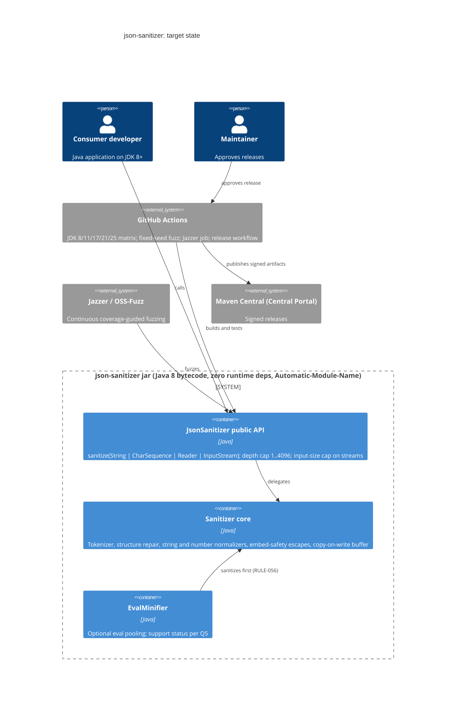
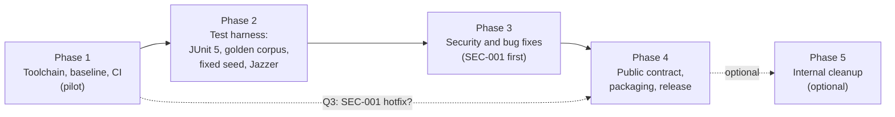

# Modernization Brief: json-sanitizer

- **Date:** 2026-10-27
- **System:** OWASP JSON Sanitizer (`com.mikesamuel:json-sanitizer` 1.2.4-SNAPSHOT), the repository at `/Users/jmanico/Dropbox/github/json-sanitizer` (`legacy/json-sanitizer` links to it)
- **Pattern:** same-stack **uplift** (Replatform), as recommended by the assessment. No phase rewrites the code.
- **Target:** Java 8 bytecode (`maven.compiler.release=8`), built on an LTS JDK (21 or 25), tested on JDK 8, 11, 17, 21 and 25. **Provisional:** `INTENT.md` names no target, so this is the recommendation; the choice is open question Q1 in §7.
- **Inputs (all 2026-10-27):** `INTENT.md` 08:29 · `PREFLIGHT.md` 08:45 · `ASSESSMENT.md` 08:57 · `SECURITY_FINDINGS.md` + `security_remediation.patch` 09:13 · `topology.json` + `.mmd` 09:27 · `BUSINESS_RULES.md` 09:48 · `RULE_REVIEWS.md/.json` 09:48 · `DELTA_CATALOG.md` (written for this brief)
- **How to steer:** edit this file. The build commands treat entry and exit criteria as binding: an edited criterion is honored, but an instruction given only in chat is not. They may tick a box or add a note, never reword a criterion. A change they want goes on a `Proposed revision:` line for you to accept.

## 1. Objective

json-sanitizer is a small (1.2 KSLOC) and widely used OWASP security library. Its core is sound: 7 million fuzzed inputs found no bypass, and tests cover 98% of lines. But its platform has rotted. It targets Java 6/7, which current JDKs (21+) refuse to compile. Its CI (Travis) is dead, and its publishing path (OSSRH) was retired in 2025, so **no fix can currently reach users**, including the fix for a High-severity denial of service (SEC-001) present in released versions. This plan moves the library, *in place and without rewriting it*, to a Java 8 baseline with a modern, pinned toolchain, live CI and Central Portal publishing. Then, behind a stronger test and fuzz harness, it fixes the confirmed security and correctness bugs, as the intent asks ("security review first", "fix known bugs as we go"). Why now: there is a reviewed fix for SEC-001 and no way to ship it.

## 2. Target Architecture

The end state is the same library with the same public API, on a living toolchain. There are no services and no data stores. All state is in memory, per call.



| Legacy component (topology domain) | Target component | Change |
|---|---|---|
| D1 Public API (`sanitize(...)` overloads) | JsonSanitizer public API | Rebuilt unchanged (Phase 1). SEC-002 and SEC-003 fixes to the unreleased overloads (Phase 3). JSpecify nullness (Phase 4) |
| D2 Tokenizer / state machine | Sanitizer core | Rebuilt unchanged. Optional exception-free control flow (Phase 5) |
| D3 Structure repair + depth limit | Sanitizer core | SEC-005 skip-scanner fix (Phase 3) |
| D4 Comment / junk removal | Sanitizer core | Unchanged |
| D5 String normalization | Sanitizer core | `\v` → U+000B fix (Phase 3). Optional shared escape decoder (Phase 5) |
| D6 Embedding-safety escapes | Sanitizer core | `\v` fix in look-ahead decoder (Phase 3). No change to the escaped patterns |
| D7 Number normalization | Sanitizer core | SEC-001 cap (Phase 3), SEC-006 exponent overflow (Phase 3) |
| D8 Copy-on-write buffer | Sanitizer core | Unchanged |
| D9 EvalMinifier | EvalMinifier | SEC-004 fix (Phase 3). Support decision (Phase 4) |
| D10 Tests and fuzzing (JUnit 3/4 hybrid, random seed) | JUnit 5 suite, golden corpus, fixed-seed fuzz, Jazzer target | Phase 2 |
| D11 Build: `pom.xml` (1.6/1.7, unpinned, jacoco 0.8.5, nexus-staging), `.travis.yml` | Pinned Maven build at `release 8`, enforcer; GitHub Actions matrix | Phase 1 |
| D11 Release: OSSRH, `RELEASE-checklist.sh` | `central-publishing-maven-plugin` + tag-triggered release workflow with a manual gate | Phase 4 |
| D11 Docs: README, javadoc, `docs/` | One authoritative output-guarantee list, RFC 8259, minimum Java, nesting and truncation behavior | Phase 4 |

## 3. Phased Sequence

**Ordering.** This is an uplift, so the default order is build-graph leaf-first. But the build graph is a **single Maven module**, so phases are cut by concern, and the three overrides decide the order:

1. **The test harness is not a forced Phase 1.** `DELTA_CATALOG.md` measured the existing JUnit 4 suite passing 28/28 on JDK 21, 25 and 27 with a Java 8 target. So the baseline is recorded with the suite as it is, and the toolchain moves first. The JUnit 5 migration comes *after* (Phase 2), because a naive one silently runs **zero** tests (DELTA-01).
2. **No dependency delta shared by many consumers forces a coordinated cut.** There is one module and no runtime dependency.
3. **Shared node with outside consumers.** The whole jar is consumed by external Maven Central users (`PREFLIGHT.md` Check 6). **Decision: schedule the break, don't hide it.** Raising the bytecode level and the deliberate output changes ship together as one versioned release with release notes (Q1, Q2). The library is not multi-released for Java 6. The `1.2.x` line stays as it is: there is no way to publish to it today, and Java 6/7 have no supported JVMs.

**Phase 1 is the pilot, and this brief is a hypothesis.** With a single module, the pilot unit *is* the whole build. What Phase 1 surfaces is *expected* to revise this brief, and regenerating it after Phase 1 is the normal path. That could be a JDK 8 failure nobody could measure here, a plugin that misbehaves on the build JDK, or an OSS-Fuzz or Actions constraint.



#### Phase 1 — Toolchain, baseline and CI (pilot)
Command: /code-modernization:modernize-uplift
Modules: job:mvn-verify, job:travis-ci
Scale: S
Risk: Medium; (1) JDK 8 is unmeasured locally, which is mitigated by a Temurin 8 leg in CI that must be green before exit. (2) A plugin upgrade (jacoco, javadoc on JDK 21+) changes build output or breaks `verify`, which is mitigated by pinning every plugin and proving equivalence on the golden corpus, not just by green tests.
Entry criteria:
- [x] Q1 (minimum Java version) is answered in §7
  > Answered 2026-10-27: Java 8.
- [x] Working copy `modernized/json-sanitizer-uplifted/` exists with its own git history; `legacy/json-sanitizer` is untouched
  > Done 2026-10-27: seeded from d9b2768, commit 9332747 on `main` in the copy; the source repository shows only untracked `analysis/`, `legacy/`, `modernized/`.
- [x] Baseline recorded in `analysis/json-sanitizer/BASELINE.md` from a scratch copy of the legacy source built on JDK 11 with the legacy pom: per-test table plus surefire result files under `analysis/json-sanitizer/baseline/` named on a `Recorded:` line
  > Done 2026-10-27: 28 tests, 28 PASS, surefire XML and raw log kept.
- [x] Golden corpus recorded: a fixed-seed corpus (at least 200,000 fuzz inputs plus every test input and the `DeltaProbe` number corpus) and the legacy build's `sanitize`/`minify` output for each, stored under `analysis/json-sanitizer/baseline/`
  > Done 2026-10-27 with two notes. (1) `DeltaProbe` was not preserved by the catalog run; `GoldenCorpus.java` carries a fresh number corpus (39,208 literals) that supersedes it. (2) Outputs are stored in full for the 367,123 explicit inputs and as per-block SHA-256 digests for the 200,000 fuzz inputs, which regenerate from the seed. Seven calls per input, 567,123 inputs; verified byte-identical on JDK 11, 17, 21 and 25 against the legacy classes. See `BASELINE.md`.
Exit criteria:
- [x] `pom.xml` uses `maven.compiler.release` at the Q1 version; the `jdk12on` profile is gone; compiler, surefire, jacoco (≥ 0.8.12), javadoc, source, spotbugs and gpg plugins are pinned; `maven-enforcer-plugin` requires the chosen build JDK and Maven version
  > Done 2026-10-27 (commit 9954fab in the working copy): release 8; compiler 3.16.0, surefire 3.6.1, jacoco 0.8.16, javadoc 3.12.0, source 3.4.0, spotbugs 4.10.5.0, gpg 3.2.8; enforcer 3.6.3 requires Maven `[3.9.0,)` and Java `[21,)`.
- [x] nexus-staging-maven-plugin no longer loads in a normal build (no `Installing Nexus Staging features` line in `mvn clean verify` output)
  > Done 2026-10-27: the line is absent from all five leg logs.
- [x] `mvn clean verify` passes on the build JDK, and the test suite passes 28/28 on every CI leg (Temurin 8, 11, 17, 21, 25 for a Java 8 baseline)
  > Partly met 2026-10-27: `mvn clean verify` passes on JDK 21, and the suite passes 28/28 with the test JVM on Zulu 8, Homebrew 11, 17, 21 and 25 locally (`UPLIFT_NOTES.md`). The Temurin legs on GitHub run at the first push (Q11).
  > Done 2026-10-27: GitHub Actions [run 40588718585](https://github.com/OWASP/json-sanitizer/actions/runs/40588718585) on branch `java8-toolchain-and-ci` (commit `cfe6378`, tree identical to the working copy's `475f264`): 28/28 on Temurin 1.8.0_504, 11.0.32.1, 17.0.20.1, 21.0.13 and 25.0.4.1; the surefire XML of every leg names the matrix JVM.
- [x] The built jar's classes are the Q1 bytecode version (52 for Java 8)
  > Done 2026-10-27: every class file is major version 52 (`javap`), and CI checks it on every leg.
- [x] Golden-corpus output from the uplifted jar is byte-identical to the baseline on every CI leg
  > Partly met 2026-10-27: byte-identical on the five local legs (567,123 inputs, 7 calls each); the CI replay step exists and runs at the first push.
  > Done 2026-10-27: `GOLDEN CORPUS: byte-identical` on all five Temurin legs of [run 40588718585](https://github.com/OWASP/json-sanitizer/actions/runs/40588718585).
- [x] A GitHub Actions workflow runs the matrix on every push and pull request; `.travis.yml` and the Travis badge are removed
  > Partly met 2026-10-27: `.github/workflows/ci.yml` (matrix 8/11/17/21/25, `actionlint`-clean, actions SHA-pinned) is in the working copy; `.travis.yml` and the badge are removed. The first run needs the push to GitHub (Q11).
  > Done 2026-10-27: the push of `java8-toolchain-and-ci` triggered [run 40588718585](https://github.com/OWASP/json-sanitizer/actions/runs/40588718585) (event `push`), all five legs green in about 70 s each; no `Installing Nexus Staging` line in any leg.
- [x] `architecture-critic` reports no change outside `pom.xml`, CI files and README badges
  > Done 2026-10-27: independent read-only review of the diff `9332747..HEAD`; no Blocker, scope verdict "no change outside the allowed set, `src/` untouched". Its High and Medium findings were fixed or recorded; dispositions in `modernized/json-sanitizer-uplifted/UPLIFT_NOTES.md`.

#### Phase 2 — Test harness: JUnit 5, golden corpus, reproducible fuzzing
Command: /code-modernization:modernize-uplift
Modules: JsonSanitizerTest, FuzzyTest, FuzzyStringGenerator, EvalMinifierTest
Scale: S
Risk: Medium; (1) JUnit 5 silently skips the 28 `public static` test methods (DELTA-01), so a test-count gate equal to the baseline count is enforced, and surefire fails when no tests run. (2) Rewriting golden assertions could weaken one unnoticed, so each assertion is moved as-is (parameterized tables keep every legacy input/output pair) and mutation-checked by the reviewer.
Entry criteria:
- [x] Phase 1 exit criteria all ticked
  > Done 2026-10-27, after the first CI run.
- [x] Phase 1's `BASELINE.md` lists 28 tests by name
  > Done: the per-test table in `BASELINE.md` names all 28.
Exit criteria:
- [x] The suite runs on the JUnit Platform with the Jupiter engine only (no vintage), and the executed test count is at least the baseline's 28, with every baseline test name mapped to a Jupiter test
  > Done 2026-10-27 (`d157b20`, gate `76f7bc7`): Jupiter 5.14.4 via the BOM, no vintage (JUnit 6 needs Java 17). The 28 keep their class and method names (`baseline_diff.py`: nothing regressed, on Zulu 8 and Homebrew 11, 17, 21, 25; 50 tests per leg). Eight message-first assertions reordered and mutation-checked. CI requires every test in `.github/required-tests.txt` (the 28 plus 14 new) to run unskipped on each leg.
- [x] Surefire is configured to fail the build when zero tests run
  > Done (`failIfNoTests`, since Phase 1).
- [x] `FuzzyTest` uses a fixed seed in CI, honors `-Dfuzz.seed` (Q12 decides negative seeds), and has the RULE-026 diagnostic fixes (`:89` excerpts `sanitized1`; `excerpt()` escapes backslashes first)
  > Done 2026-10-27 (`6f20049`): CI seed `6a736f6e2d73616e`; `Long.parseUnsignedLong` per Q12, so the baseline's `ea41f76fb21e5107` replays and passes; both diagnostic fixes; `testPrintedSeedsReplay`.
- [x] A golden-corpus test replays the Phase 1 corpus and asserts byte-identical output
  > Done 2026-10-27 (`ef4de26`, `76f7bc7`): `GoldenCorpusTest`, byte-identical on all five local legs; a one-digit digest change fails it; the digests' SHA-256 is pinned so the baseline cannot be re-recorded from the build under test.
- [x] One named regression test exists per P0 rule in §5 (RULE-001, -024, -025, -026, -056, -057), each citing the rule ID
  > Done 2026-10-27 (`c58fc07`): `BehaviorContractTest.testRule001…` to `testRule057…`. RULE-001 pins the legacy \v → U+0008 for Phase 3 to change.
- [x] Cross-JDK characterization tests for the Reader/InputStream overloads exist (malformed UTF-8, BOM, a surrogate pair split at the 8192-char read boundary; DELTA-11, RULE-034, RULE-058) and pass on every CI leg
  > Partly met 2026-10-27: `StreamCharacterizationTest` (5 tests) passes on Zulu 8 and Homebrew 11, 17, 21, 25, with identical decoder behavior on all five. The CI legs need a GitHub run of this code.
  > Done 2026-10-28: GitHub Actions [run 40599699046](https://github.com/OWASP/json-sanitizer/actions/runs/40599699046) on branch `junit5-golden-corpus-jazzer` (tree identical to the working copy's `d84829b`): `StreamCharacterizationTest` 5/5 on Temurin 1.8.0_504, 11.0.32.1, 17.0.20.1, 21.0.12.1 and 25.0.4.1; every leg 50 tests, 42 of 42 required tests unskipped, corpus byte-identical.
- [x] A Jazzer fuzz target in the repo asserts: sanitize never throws, output parses under a strict RFC 8259 parser, output is idempotent, and output contains none of `</script`, `<script`, `<!--`, `-->`, `]]>` (case-insensitive); a CI job runs it for a fixed time with zero findings
  > Owner decision 2026-10-27: the validity check is **RFC 8259 as written**. Jazzer's first finding (83 s into the first local run) was `{"\uDDDD":1}`: the sanitizer keeps an escaped lone surrogate, and Jackson rejects one in an object key though it accepts one in a value. RFC 8259 §7 allows any `\u` + 4 hex digits (§8.2 only warns), so the oracle rewrites `\uD800`–`\uDFFF` escapes to `\uFFFD` before Jackson parses (a grammar-preserving swap, self-tested), and the finding is kept as a regression seed. Lone surrogates are legacy behavior (RULE-045), not a Phase 2 change; see the proposed Q13.
  > Partly met 2026-10-27 (`6c8880b`, widened in `76f7bc7`): the target also checks a fuzzed depth, Reader/InputStream equivalence and `minify`. Local 5-minute campaigns on JDK 21: 2,834,362 and 1,069,698 inputs, no finding. The `fuzz` CI job (5 minutes, must report at least 280 s) needs a GitHub run.
  > Done 2026-10-28: the `fuzz` job of [run 40599699046](https://github.com/OWASP/json-sanitizer/actions/runs/40599699046) fuzzed 939,862 inputs in 301 s with no finding (`Tests run: 9, Failures: 0`, `BUILD SUCCESS` in its log). That run also showed the runner's default step shell lacks `pipefail`, so `mvn | tee` could have hidden a later finding; fixed by `92dc76b` (`defaults.run.shell: bash`); [run 40600511953](https://github.com/OWASP/json-sanitizer/actions/runs/40600511953) confirms `-o pipefail` on all 22 steps, all legs green, and 1,060,191 fuzz inputs in 301 s with no finding.
- [x] No file under `src/main/` changed in this phase, and `.github/golden/` is deleted once the golden-corpus test under `src/test` replays the same corpus
  > Revision accepted by the owner 2026-10-27 (was a `Proposed revision:` line: the Phase 1 tool lives under `.github/golden/` only because Phase 1 may not touch `src/`; two copies invite drift).
  > Done 2026-10-27: `git diff 475f264 -- src/main` is empty; `.github/golden/` was moved into `src/test` by `ef4de26`.

#### Phase 3 — Security and bug fixes
Command: /code-modernization:modernize-uplift
Modules: JsonSanitizer#normalizeNumber, JsonSanitizer#canonicalizeNumber, JsonSanitizer#sanitize(CharSequence), JsonSanitizer#sanitize(Reader), JsonSanitizer#sanitize(InputStream), JsonSanitizer#endOfBracketedValue, JsonSanitizer#sanitizeString, JsonSanitizer#unescapedChar, EvalMinifier#minify(CharSequence)
Scale: M
Risk: High; (1) these are deliberate output changes in a security library that thousands of consumers depend on byte-for-byte. Each change is approved individually (Q4), and the golden-corpus diff must show differences *only* in the approved classes. (2) A fix could open an embed-safety bypass, so the Jazzer target and the P0 regression suite gate every fix, and each fix gets an independent security-auditor review.
Entry criteria:
- [x] Phase 2 exit criteria all ticked
  > Done 2026-10-28 (all ten; PR #41 merged).
- [x] Every Q4 sub-item for the fix being applied is ticked in §7 (a fix whose sub-item is unticked is not applied)
  > Done 2026-10-28: Q4a-Q4f decided under the owner's delegation; RULE-001 approved in RULE_REVIEWS.md.
- [x] First slice is SEC-001: `analysis/json-sanitizer/security_remediation.patch` is applied to the working copy (it is reviewed but **not yet applied** to `src/`)
  > Done: commit 30c3d47 applies the patch's two src/main hunks unchanged (after slice 0, the dual-run corpus test).
Exit criteria:
- [x] SEC-001: a 1,000,000-digit hex literal sanitizes in under 1 s on the CI runner; the residual test gaps in `SECURITY_FINDINGS.md` (octal 1024/1025 boundary, `+`/`0X` past the cap, base-10 key, dropped exponent) are covered
  > Done: `testSec001...` asserts under 1 s and covers every listed gap; green on every CI leg of [run 40609892192](https://github.com/OWASP/json-sanitizer/actions/runs/40609892192).
- [x] SEC-002: `sanitize(CharSequence)` never returns the caller's mutable object; a mutate-after-return test passes; the javadoc at `JsonSanitizer.java:147-148` matches behavior
  > Done: `testSec002...`; the overloads now declare `String`; javadoc updated.
- [x] SEC-003: the Reader/InputStream overloads enforce the Q4c input cap with the Q4c behavior at the cap; an endless-stream test completes without OOM at `-Xmx256m`
  > Done: 4 Mi chars after the review (see Q4c), `IOException`, nothing written; `testSec003...` runs endless input and the worst-case expansion in a child JVM at `-Xmx256m`.
- [x] SEC-005: `[[a'b],"keep",'x']` at depth 1 keeps the siblings per the Q4d expected output
  > Done: `[null,"keep","x"]` (`testSec005...`).
- [x] SEC-006: `{11e2147483647:0}` produces the Q4e expected key
  > Done: `{"1.1e+2147483648":0}` (`testSec006...`).
- [x] SEC-004: `minify` output for `12345e+1` inputs is valid JavaScript
  > Done: `testSec004...`; the security review also evaluated 20,000 pooled outputs in node with 0 failures.
- [x] RULE-001: `["a\vb"]` → `["a\u000bb"]`, and the look-ahead decoder returns `0x2000B` for `\v`
  > Done: `testRule001...` (normalizer and decoder via reflection); `BehaviorContractTest` updated.
- [x] Every fix has a test that fails on the Phase 2 build and passes after
  > Done: each slice was checked with `src/main` stashed (SEC-003's test does not compile on the old build; the legacy overload was shown to hit OutOfMemoryError in 119 ms at 256 MB instead).
- [x] The golden-corpus diff against the Phase 1 baseline shows differences only in the approved classes (over-cap numbers, `\v`, SEC-005/006 inputs, minifier exponent splits); each differing class is listed with counts in `analysis/json-sanitizer/APPROVED_DIFFERENCES.md`
  > Done: `GoldenCorpusTest` runs the verbatim legacy copy and the new code on every leg: 70,352 differing (input, call) pairs, all explained, exact counts per class in `APPROVED_DIFFERENCES.md`.
- [x] P0 regression suite, golden-corpus test (with the approved-difference allowlist) and Jazzer job are green on every CI leg
  > Done: [run 40609892192](https://github.com/OWASP/json-sanitizer/actions/runs/40609892192) (PR #42, merged as e0cd16a): Temurin 8, 11, 17, 21, 25, 61 tests, 53 of 53 required, `unexplained: 0`; Jazzer job 1,040,668 inputs in 301 s, no finding.
- [x] An independent security-auditor review of the phase diff records no unresolved finding
  > Done 2026-10-28: no Critical/High, no bypass; M-1, L-1, L-2, I-1 fixed in c759f35, I-2/I-4 recorded with reasons, I-3 fixed or documented (dispositions in UPLIFT_NOTES.md, Phase 3). The owner's sign-off of APPROVED_DIFFERENCES.md is still to come.
  > Signed off by the owner, Jim Manico, 2026-10-28.

#### Phase 4 — Public contract, packaging and release
Command: /code-modernization:modernize-uplift
Modules: job:release, JsonSanitizer#sanitize(String), EvalMinifier#minify(String), EvalMinifier.Token
Scale: S
Risk: Medium; (1) publishing is irreversible and needs credentials and namespace access that only a person holds (Q9). The release workflow stages and verifies, and a maintainer approves the final publish by hand. (2) Adding JSpecify could add a runtime dependency for every consumer (DELTA-09), which is mitigated by the Q6 scope decision and a check that the published POM lists no compile-scope dependency.
Entry criteria:
- [x] Phase 3 exit criteria all ticked
  > Done 2026-10-28 (PR #42 merged as e0cd16a).
- [x] Q2 (version number), Q5 (EvalMinifier status), Q6 (JSpecify scope), Q7 (Automatic-Module-Name) and Q9 (Central Portal namespace and signing key owner) are answered in §7
  > Q2, Q5, Q6, Q7 answered; Q9 is not, and per the revision below it gates only the staging criterion, which stays unticked.
  > Revision accepted 2026-10-28 by Claude under the owner's delegation ("make all the decision as best you can"): **Q9 gates only the staging criterion below** (and a groupId move, if Q9 requires one). Q9 is a fact about who holds the `com.mikesamuel` namespace and the signing key, which only the owner can supply; nothing else in this phase depends on it. Q2, Q5, Q6 and Q7 are answered. The owner can revert this by deleting this note.
Exit criteria:
- [x] jsr305 is replaced by JSpecify with the Q6 scope; `sanitize(...)` parameters are `@Nullable`, matching the tested null-accepting behavior; the published POM has no compile-scope dependency unless Q6 chose one
  > Done (beaa1e6, 5917527): JSpecify 1.0.1 `provided`; the package `@NullMarked`; String/CharSequence parameters and two nullable fields `@Nullable`. The POM declares only `provided` and `test` dependencies, checked by the release workflow.
- [x] The jar manifest carries `Automatic-Module-Name` with the Q7 value
  > Done: `com.google.json`; `jar --describe-module` agrees.
- [x] README and class javadoc state one identical list of output guarantees (including `-->`), cite RFC 8259, state the minimum Java version, nesting-depth behavior, top-level truncation and stream size limits; `docs/getting_started.md` pins a version instead of `[1.0,)`
  > Done (5917527): both generated from one source: six guarantees incl. `-->`, RFC 8259, then nesting, numbers, numeric keys, stream limits, Java 8; every example was run against the build. An independent review found two overclaims in the first version; both corrected. `docs/getting_started.md` pins 1.3.0 (noted as not yet released).
- [x] EvalMinifier is supported or `@Deprecated` per Q5, and the README says which
  > Done: `@Deprecated` with the reason; README section "EvalMinifier (deprecated)".
- [x] `central-publishing-maven-plugin` replaces nexus-staging; SCM URLs use HTTPS; `RELEASE-checklist.sh` is replaced by a documented tag-triggered workflow
  > Done: plugin 0.12.0 with autoPublish=false; HTTPS SCM URLs; `RELEASE-checklist.sh` replaced by `.github/workflows/release.yml` (secret-free verify job, environment-gated stage job) and `docs/RELEASING.md`, which lists the repository settings the gate depends on.
- [ ] A release-candidate build is staged to the Central Portal, validated (signatures, sources, javadoc) and **not** published until a maintainer approves it in the portal
  > Not done, by design: needs Q9 (who controls `com.mikesamuel` and the signing key), the environment secrets and settings in `docs/RELEASING.md`, and the owner's go-ahead (2026-10-28: "we just dont want to cut a release until ready"). PR #43 merged as 848acf8 after CI [run 40612508895](https://github.com/OWASP/json-sanitizer/actions/runs/40612508895) was green.
- [x] Release notes list the minimum-Java change and every approved output difference from `APPROVED_DIFFERENCES.md`
  > Done: `CHANGELOG.md` 1.3.0 (unreleased), including the two output changes since 1.2.3 that predate the corpus baseline.

#### Phase 5 — Internal cleanup (optional)
Command: /code-modernization:modernize-uplift
Modules: JsonSanitizer#unescapedChar, JsonSanitizer#sanitizeString, JsonSanitizer.UnbracketedComma, JsonSanitizer#requireValueState, JsonSanitizer#sanitize(), JsonSanitizer#elideTrailingComma
Scale: M
Risk: Medium; (1) refactoring the hot tokenizer and string paths can change output in ways a golden corpus misses, which is mitigated by Jazzer plus an exact corpus diff against the Phase 4 release. (2) Scope creep into a god-class split, which is mitigated by limiting the scope to debt items #3, #5 and #9 in `ASSESSMENT.md`; the split itself is out of scope.
Entry criteria:
- [ ] Q10 answers "include Phase 5"
- [ ] The Phase 4 release is published
Exit criteria:
- [ ] One shared escape decoder serves both the normalizer and the look-ahead (debt #3)
- [ ] `UNBRACKETED_COMMA` and the reachable `AssertionError`s no longer drive control flow (debt #5)
- [ ] `SUPER_VERBOSE_AND_SLOW_LOGGING` blocks and the `setStackTrace` hack are deleted (debt #9)
- [ ] Golden-corpus output is byte-identical to the Phase 4 release; P0 suite and Jazzer job green on every CI leg

## 4. Business Walkthroughs

"Phase" is the phase that changes that step. In an uplift every step is rebuilt in Phase 1 and must behave identically there. A later phase appears only where that step's behavior or code changes on purpose.

**Flow 1: A web developer embeds untrusted JSON in a page** (persona: web application developer)

| Step (business language) | Legacy modules | Phase |
|---|---|---|
| Hand the untrusted text to the library | `JsonSanitizer#sanitize(String)` | 1 (rebuilt), 4 (nullness annotation) |
| Set up a sanitizer with the nesting limit | `JsonSanitizer#JsonSanitizer()`, `ds:maximumNestingDepth` | 1 |
| Walk the text token by token | `JsonSanitizer#sanitize()`, `ds:jsonish`, `JsonSanitizer#requireValueState` | 1, 5 (optional) |
| Drop comments and junk | `JsonSanitizer#endOfComment`, `JsonSanitizer#elide` | 1 |
| Normalize strings and defuse `</script>`, `<!--`, `]]>` | `JsonSanitizer#sanitizeString`, `JsonSanitizer#replace` | 3 (`\v` fix), 5 (optional) |
| Normalize numbers | `JsonSanitizer#normalizeNumber` | **3 (SEC-001: the DoS fix)** |
| Close any open brackets | `ds:bracketStack`, `JsonSanitizer#elideTrailingComma` | 1, 5 (optional) |
| Return safe JSON (or the original if already clean) | `JsonSanitizer#toCharSequence`, `ds:sanitizedJson` | 1 |

**Flow 2: An API service cleans a streamed request body** (persona: backend service team)

| Step | Legacy modules | Phase |
|---|---|---|
| Pass the request stream and an output stream | `JsonSanitizer#sanitize(InputStream)` | 3 (SEC-003 size cap) |
| Decode bytes as UTF-8 and read the body | `JsonSanitizer#sanitize(Reader)`, `ds:callerInput` | 2 (characterized), 3 (SEC-003) |
| Sanitize the whole body in memory | `JsonSanitizer#sanitize(CharSequence)`, `JsonSanitizer#sanitize()` | 3 (SEC-002) |
| Write safe JSON to the caller's sink | `ds:callerOutput` | 1 |

**Flow 3: A front-end team ships compact JSON for eval** (persona: front-end performance engineer)

| Step | Legacy modules | Phase |
|---|---|---|
| Hand the payload to the minifier | `EvalMinifier#minify(String)` | 4 (support status) |
| Sanitize it first | `JsonSanitizer#JsonSanitizer()`, `JsonSanitizer#sanitize()`, `JsonSanitizer#toCharSequence` | 1 |
| Find repeated tokens worth pooling | `EvalMinifier#minify(CharSequence)`, `EvalMinifier.Token` | 3 (SEC-004) |
| Give each pooled token a short safe name | `EvalMinifier.NameGenerator`, `ds:RESERVED_KEYWORDS` | 1 |

**Flow 4: A maintainer proves a change is still safe** (persona: library maintainer / release manager)

| Step | Legacy modules | Phase |
|---|---|---|
| Run the build | `job:release`, `job:mvn-verify` | 1 (build, CI), 4 (release) |
| Check known inputs give known outputs | `JsonSanitizerTest`, `EvalMinifierTest` | 2 |
| Fuzz random JSON-ish text for idempotence | `FuzzyTest`, `FuzzyStringGenerator` | 2 (fixed seed, Jazzer) |
| Exercise the public API | `JsonSanitizer#sanitize(String)`, `EvalMinifier#minify(String)` | 1 |

## 5. Behavior Contract

The contract has two layers, and both must hold before any phase ships.

**Layer 1: the baseline.** This is an uplift, so the legacy build is the oracle. The baseline is `analysis/json-sanitizer/BASELINE.md`, its surefire result files and the golden corpus (Phase 1 entry criteria). The uplifted build must reproduce them byte for byte, except for the differences listed in `APPROVED_DIFFERENCES.md` (Phase 3).

**Layer 2: the P0 rules from `BUSINESS_RULES.md`.** These become named regression tests (Phase 2).

| Rule | What must stay true | Extraction confidence | Human review | Status |
|---|---|---|---|---|
| RULE-001 | Escape-aware forward decoding: a disguised `<\script`, `<\x73cript` etc. is still caught by the embed-safety look-ahead | High | confirmed | Settled, **with one approved difference:** `\v` becomes U+000B (`\u000b`, decoder `0x2000B`), not legacy's U+0008. Equivalence tests expect this difference. |
| RULE-024 | An over-deep array or object is replaced whole by `null`; no exception; siblings kept (`[[[1]],2]` at depth 2 → `[[null],2]`) | Medium | confirmed | Settled (person-confirmed). Note that the no-throw policy is new in 042752c, so earlier releases differ. SEC-005 (Phase 3) changes sibling handling only for inputs with odd tokens inside the over-deep value, per Q4d. |
| RULE-025 | Output is exactly one top-level value; a top-level comma, stray close bracket or second value drops everything after it (`[1]],alert(1)` → `[1]`) | Medium | confirmed | Settled (person-confirmed) |
| RULE-026 | Sanitizing the output again changes nothing (idempotence), for fuzzed and malformed input | High | confirmed | Settled. The diagnostic-message bugs in `FuzzyTest` are not part of the contract (fixed in Phase 2). |
| RULE-056 | `EvalMinifier` sanitizes first (default or caller depth) and pools only sanitized text | High | not reviewed | Settled (High confidence) |
| RULE-057 | Strings never contain `<!--`, `<script`, `</script`, `-->` or `]]>` (case-insensitive); the key character is `<`/`>`/`]`-escaped | Medium | confirmed | Settled (person-confirmed). `<![CDATA[` is **not** escaped and is out of scope per the reviewer; the Phase 4 docs must not claim it (Q8). |

**Blockers:** none. Every P0 rule below High confidence (RULE-024, -025, -057) was confirmed by a person in `RULE_REVIEWS.md`, and no rule is marked `wrong` or `discuss`.

## 6. Validation Strategy

| Phase | Characterization tests | Contract tests | Dual-execution diff | Property-based / fuzz | Manual UAT |
|---|---|---|---|---|---|
| 1 Toolchain | Existing 28 tests unchanged, every JDK leg | — | **Golden corpus: legacy JDK 11 build vs uplifted jar on JDK 8–25, byte-identical** | Existing random-seed idempotence fuzz | Maintainer reviews the pom/CI diff |
| 2 Harness | Stream overloads across JDKs (DELTA-11) | **P0 rule tests**; test-count parity gate | Golden corpus replayed as a test | Fixed-seed fuzz; Jazzer target (validity, idempotence, embed-safety, no-throw) | — |
| 3 Fixes | One fail-before/pass-after test per fix | P0 rule tests (RULE-001 updated for `\v`) | Golden corpus diff; differences only in approved classes, with counts | Jazzer job gates each fix; SEC-001 timing test | Security-auditor review of each fix; maintainer signs off `APPROVED_DIFFERENCES.md` |
| 4 Release | — | Published-POM check (no unexpected runtime dependency); manifest check | Golden corpus on the staged release artifact | Jazzer job on the release candidate | **Maintainer approves the publish in the Central Portal** |
| 5 Cleanup (optional) | — | P0 rule tests | Golden corpus byte-identical to the Phase 4 release | Extended Jazzer run | Maintainer reviews the diff |

## 7. Open Questions

Tick a box or write the answer next to it. Each one gates the phase named in brackets.

- [x] **Q1 — Minimum Java version** [Phase 1]. **Answer (2026-10-27): Java 8** (`maven.compiler.release` 8; build JDK 21 or newer; tested on 8, 11, 17, 21, 25). Recommended: **Java 8** (needs no code change and cuts off only Java 6/7; the only cost is that javac 21+ flags `--release 8` as obsolete, DELTA-08). Alternatives are Java 11 or 17, which cut off Java 8 or Java 8 and 11 users and buy nothing this code needs. See `DELTA_CATALOG.md` "Baseline choice".
- [x] **Q2 — Version number of the first release** [Phase 4]. Recommended: **1.3.0**. The public API is unchanged, Java 6/7 runtimes are unsupported everywhere, and the output changes are bug and security fixes. The alternative is 2.0.0 to signal the bytecode bump and output changes loudly.
  > Decided 2026-10-28 by Claude, delegated by the owner ("please make all the decision as best you can"): **1.3.0**. The public API is source- and binary-compatible, Java 6/7 have no supported JVMs, and every output change is a listed bug or security fix. The owner added (2026-10-28): merging into master is fine, but **no release is cut until the owner says it is ready**.
- [x] **Q3 — Ship a SEC-001 hotfix early?** [reorders Phases 3–4]. SEC-001 (High) is in released versions. An early `1.2.4` containing only Phase 1 plus the SEC-001 patch would need the Phase 4 publishing work pulled forward. Recommended: **yes**, if the Q9 credentials are available. If you say yes, regenerate this brief so the phases reflect it.
  > Decided 2026-10-28 by Claude, delegated by the owner ("please make all the decision as best you can"): **no separate hotfix; phases stay in order.** Nothing can ship before Q9 is answered and the owner calls the release, and Phases 3 and 4 will be ready before that; SEC-001 is Phase 3's first slice, so 1.3.0 carries it.
- [x] **Q4 — Approve each deliberate output difference** [Phase 3; each sub-item gates its own fix]
  > Decided 2026-10-28 by Claude, delegated by the owner ("please make all the decision as best you can"), one sub-item at a time below.
  - [x] Q4a — SEC-001: octal/hex literals with more than 1024 significant digits become `1e999` (key `"1e+999"`), and a trailing fraction or exponent after such a literal is dropped (`SECURITY_FINDINGS.md` residual note 1).
    > Decided 2026-10-28 by Claude, delegated by the owner ("please make all the decision as best you can"): **approved as reviewed.** Below the cap output is unchanged; past it JavaScript and doubles already read Infinity. The fraction/exponent residual goes in the release notes.
  - [x] Q4b — SEC-002: `sanitize(CharSequence)` always returns an immutable `String`, never the caller's object (unreleased API, so no consumer impact).
    > Decided 2026-10-28 by Claude, delegated by the owner ("please make all the decision as best you can"): **approved.**
  - [x] Q4c — SEC-003: the default input cap for the Reader/InputStream overloads (proposal: 64 Mi chars, configurable) and the behavior at the cap (proposal: throw `IOException`; the alternative is to truncate and close the brackets).
    > Decided 2026-10-28 by Claude, delegated by the owner ("please make all the decision as best you can"): **default cap 16 Mi chars (16,777,216), configurable through new `maximumInputLength` overloads; past the cap, throw `IOException` before sanitizing.** Lower than the 64 Mi proposal because output can grow up to 6x: a 64 Mi-char input could need about 768 MB of output, which defeats an OOM guard on common heaps; 16 Mi chars is 32 MB of input. Throwing fails closed; truncating would silently drop caller data. Both overloads are unreleased, so their shape is still free.
    > **Revised 2026-10-28 after the Phase 3 security review (M-1): 4 Mi chars (4,194,304).** At 16 Mi a worst-case body (every char escaped six-fold, then copied whole on output) still needed 0.5 to 0.75 GB. With 4 Mi, a released read buffer and chunked output, the measured worst case is 128 MB of heap on JDK 21 and 192 MB on JDK 8.
  - [x] Q4d — SEC-005: the over-deep skip uses the main tokenizer, so `[[a'b],"keep",'x']` at depth 1 becomes `[null,"keep","x"]` instead of `[null]`.
    > Decided 2026-10-28 by Claude, delegated by the owner ("please make all the decision as best you can"): **approved.** Siblings of an over-deep value must not depend on how odd text inside it is spelled; at the default depth the same input already keeps them (`[["a'b"],"keep","x"]`).
  - [x] Q4e — SEC-006: the expected output for an overflowing numeric-key exponent (`{11e2147483647:0}`). This is linked to the RULE-012 SME question: keep the original digits, or produce JavaScript's `"Infinity"`.
    > Decided 2026-10-28 by Claude, delegated by the owner ("please make all the decision as best you can"): **keep the digits, with correct exponent arithmetic: `{"1.1e+2147483648":0}`.** The sanitizer canonicalizes out-of-range numeric keys textually, not as JavaScript would (`{1e400:0}` already gives `{"1e+400":0}`, not `"Infinity"`); switching to `"Infinity"` only when the int overflows would make equal-meaning keys disagree.
  - [x] Q4f — SEC-004: `EvalMinifier` no longer splits `12345e+1` at the `+`.
    > Decided 2026-10-28 by Claude, delegated by the owner ("please make all the decision as best you can"): **approved.** Today `minify` can emit `12345e` and `a+1`, which is not valid JavaScript.
  - [x] `\v` → U+000B (RULE-001), already approved in `RULE_REVIEWS.md`.
- [x] **Q5 — EvalMinifier status** [Phase 4]. It is eval-centric and incompatible with a strict CSP. Recommended: **keep it working, mark it `@Deprecated`** with a README note. The alternative is to keep it fully supported.
  > Decided 2026-10-28 by Claude, delegated by the owner ("please make all the decision as best you can"): **keep it working, mark it `@Deprecated`, say so in the README** (eval-based; incompatible with a strict CSP).
- [x] **Q6 — JSpecify dependency scope** [Phase 4]. Recommended: **`optional`/`provided`**, so the library keeps zero runtime dependencies. The alternative is a normal compile dependency, which JSpecify suggests but which adds a transitive dependency for every consumer.
  > Decided 2026-10-28 by Claude, delegated by the owner ("please make all the decision as best you can"): **`provided`**, the scope jsr305 has today, so the published POM keeps zero runtime dependencies.
- [x] **Q7 — `Automatic-Module-Name` value** [Phase 4]. Proposal: `com.google.json`, which matches the package. Once published it is permanent public API.
  > Decided 2026-10-28 by Claude, delegated by the owner ("please make all the decision as best you can"): **`com.google.json`**, the package root: the JPMS convention, and it survives a groupId move.
- [x] **Q8 — CDATA wording** [Phase 4]. Confirm the documented guarantees exclude `<![CDATA[` (the reviewer judged it out of scope; only `]]>` is escaped).
  > Decided 2026-10-28 by Claude, delegated by the owner ("please make all the decision as best you can"): **confirmed**: the guarantees list `]]>` only and say `<![CDATA[` is not escaped.
- [x] **Q9 — Release ownership** [Phase 4, and Q3]. Who controls the `com.mikesamuel` namespace on the Central Portal and the GPG signing key? Can OWASP maintainers be added, or does the groupId need to move (which would be a breaking coordinate change)?
  > **Answered by the owner 2026-10-28:** the namespace and the old key are Mike Samuel's; he abandoned the repository and is reachable; Jim Manico has admin access and is taking over as the sole maintainer. Plan (docs/RELEASING.md): keep the groupId `com.mikesamuel`; Mike asks Central Support to add Jim's Central Portal account as a publisher; releases are signed with Jim's own GPG key. Fallback if that fails: a new groupId (for example under `org.owasp`), a breaking coordinate change.
  > **Reopened by the owner 2026-10-28:** explore publishing under the OWASP namespace instead of `com.mikesamuel` (like `org.owasp.encoder:encoder`; the HTML sanitizer is not under `org.owasp`, it is `com.googlecode.owasp-java-html-sanitizer`). Proposal: `org.owasp:json-sanitizer` (free on Central), Java package and module name unchanged, plus a one-time relocation POM under `com.mikesamuel`. Waiting on the owner's choice of coordinates and on who controls `org.owasp` on the Central Portal.
  > **Decided by the owner 2026-10-28: `org.owasp:json-sanitizer`.** `org.owasp` belongs to the OWASP Foundation, for which the owner already publishes the OWASP Java Encoder and HTML Sanitizer, and he has a Central Portal account. `relocation/pom.xml` points `com.mikesamuel:json-sanitizer:1.3.0` at the new coordinates; publishing it once is the only step still needing Mike.
- [x] **Q10 — Include Phase 5?** Recommended: **decide after Phase 4**. It brings no consumer-visible benefit, and the risk is contained by the corpus and Jazzer gates.
  > Decided 2026-10-28 by Claude, delegated by the owner ("please make all the decision as best you can"): **not now.** Its entry criterion is a published Phase 4 release, which waits for the owner; revisit after 1.3.0 ships.
- [x] **Q11 — GitHub Actions on the OWASP organization**: is it permitted, and is there a budget limit for a 5-JDK matrix plus a timed Jazzer job? (CI duration was an open preflight item.)
  > Partly answered 2026-10-27: **permitted** (repository Actions settings: enabled, all actions allowed; the first run passed). The matrix takes about 70 s per leg. The owner approved a 5-minute Jazzer job; any organization budget limit is still unknown.
  > Answered 2026-10-28 (the owner asked whether the cost is necessary; decided by Claude on delegation): the repository is public, so GitHub-hosted runner minutes are free. CI now runs only on master pushes and pull requests (each PR ran everything twice before), and the fuzz job runs 2 minutes on pull requests and 5 on master; OSS-Fuzz fuzzes master continuously as well.
- [x] **Q12 — P1 SME questions that touch Phases 2–3**: RULE-034 (strip or reject a UTF-8 BOM in the byte-stream API?) and RULE-063 (should a negative fuzz seed replay; switch to `Long.parseUnsignedLong`?).
  > Note 2026-10-27: RULE-063 is confirmed by the Phase 1 pilot. The baseline run's own seed `ea41f76fb21e5107` cannot be replayed (`NumberFormatException` on every JDK), so CI uses a positive seed until Phase 2 fixes the parsing.
  > **RULE-063 answered 2026-10-27** (the owner delegated the call to Claude: "not sure, you make the call"): **yes, every printed seed must replay; parse with `Long.parseUnsignedLong(seed, 16)`.** `FuzzyTest` prints seeds with `Long.toHexString`, which is unsigned, so this makes print and parse round-trip; every positive seed parses exactly as before. **RULE-034 stays open**: Phase 2 only characterizes today's BOM behavior; the strip/reject decision gates Phase 3.
  > **RULE-034 Decided 2026-10-28 by Claude, delegated by the owner ("please make all the decision as best you can"): keep today's behavior, UTF-8 only.** A BOM before the value is already dropped as junk and one inside a string is kept as U+FEFF (pinned by `StreamCharacterizationTest`); stripping or rejecting would change output with no safety gain.

- [x] **Q13 — Lone surrogates and I-JSON** [Phase 4]. Sanitized output can contain lone surrogate escapes (`"\uD800"`, also as a key): valid RFC 8259, but forbidden by I-JSON (RFC 7493 §2.1) and rejected by some strict parsers (Jackson in keys). Keep them and document it, or replace each lone surrogate with `\ufffd` (an output change needing its own approval). Raised by the Phase 2 Jazzer finding.
  > Added from a proposed revision and decided 2026-10-28 by Claude, delegated by the owner: **keep them, no output change; the Phase 4 output guarantees state that output is RFC 8259 JSON, not I-JSON, and that lone surrogates are escaped, never raw.** Replacing them would lose data callers may rely on (round-tripping), and nothing in the embed-safety contract depends on it.

## 8. Approval Block

```
Approved by: Jim Manico  Date: 2026-10-28
Approval covers: Full plan
```

> Signed in by Claude on the owner's explicit instruction (2026-10-28, "yes" to "Jim Manico, 2026-10-28, full plan"). Phase 5 stays gated by its own entry criteria (Q10 "not now"; a published 1.3.0).
